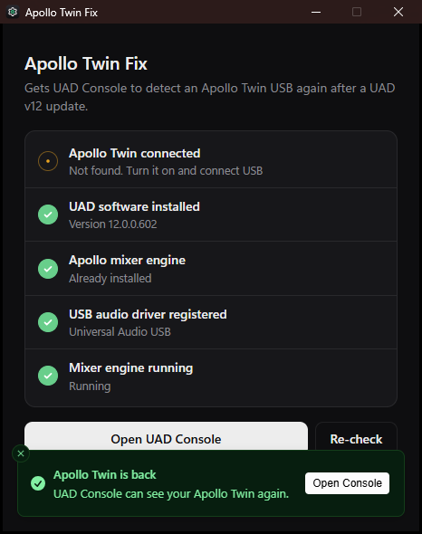

<p align="center">
  
</p>

<h1 align="center">Apollo Twin Fix</h1>

<p align="center">
  A free one-click fix for Windows when <b>UAD Console doesn't detect an Apollo Twin USB</b> after updating to UAD v12.
</p>

<p align="center">
  <a href="../../releases/latest"><b>⬇ Download ApolloTwinFix.exe</b></a>
</p>

<p align="center">
  
</p>

---

## The problem

After updating to **UAD v12** (UAD Console 1.3.x) on Windows:

- UAD Console opens but your Apollo Twin USB never shows up. It only offers Volt devices, or says no Apollo is connected.
- Windows itself still sees the Twin. Device Manager shows **Universal Audio Twin USB** working normally.
- There's no **Universal Audio USB** ASIO driver in your DAW's audio settings.

## The fix

1. Download **ApolloTwinFix.exe** from [Releases](../../releases/latest).
2. Turn your Apollo Twin on and connect it with its USB 3 cable.
3. Run the exe and click **Yes** when Windows asks for administrator permission. The fix changes system drivers, so it needs admin rights.
4. Click **Fix it**. When everything is green, click **Open UAD Console**.

> **Windows SmartScreen warning:** the exe isn't code-signed (signing certificates cost money), so Windows may say it "protected your PC". Click **More info → Run anyway**. You can also [build it yourself](#build-from-source) from this source.

It's a single 1.2 MB file. There's nothing to install, and it leaves almost nothing behind.

## Why it happens

The UAD v12 installer checks whether an Apollo is connected before installing its Apollo components. If your Twin isn't detected at that moment (it's off, still starting up, or on a different port), the installer **silently skips the Apollo part**, even though it has already downloaded it. That leaves out:

| Missing piece | What it does | Result when missing |
| --- | --- | --- |
| `UAMixerEngine.exe` (Apollo mixer engine) | The background service UAD Console talks to on port 4710 | Console can't see any Apollo |
| **Universal Audio USB** ASIO driver registration | Lets apps use the Twin through ASIO | No UA driver in your DAW, Console can't find the device |

Some systems also hit a third problem: the mixer engine **crashes on startup** (error `0xC0000005`) while reopening a saved mixer session, usually one left over from an older UAD version.

## What the app does

Fix it first checks five things (Twin connected, UAD software installed, mixer engine installed, ASIO driver registered, engine running), then:

1. **Installs the skipped Apollo packages**, if the engine is missing. It uses UA's own `apollo-32bit.msi` / `apollo-64bit.msi` that the UAD installer already left in `C:\ProgramData\Package Cache`. Nothing is downloaded.
2. **Registers the Universal Audio USB ASIO driver**, using the driver files UAD already installed.
3. **Restarts the UA apps** so the mixer engine starts and owns port 4710.
4. **If the engine crashes on startup**, renames your saved mixer session (`%AppData%\Universal Audio\LastUsedSession.uadmix`) to a dated `.bak` backup and starts the engine with a fresh session.

It never modifies, patches or replaces any Universal Audio files or drivers. It only completes the installation UAD started.

### Undoing it

- **Restore your old mixer session** (only if step 4 ran): rename `LastUsedSession.uadmix.crashed-<date>.bak` back to `LastUsedSession.uadmix` in `%AppData%\Universal Audio`.
- **Unregister the ASIO driver:** run `regsvr32 /u` on `uausbaudioasio_x64.dll` in `C:\Program Files (x86)\Universal Audio\Powered Plugins\Drivers\audio\usb\x64`.
- The Apollo packages are part of UAD. Uninstalling or reinstalling UAD removes or replaces them.

## Requirements

- Windows 10 or 11, 64-bit
- UAD software v12 already installed (download it from Universal Audio first)
- Microsoft Edge WebView2 Runtime, which is built into Windows 11 and most up-to-date Windows 10 PCs

Tested with an **Apollo Twin USB** on two PCs (Windows 11 builds 22631 and 26220) with UAD 12.0.0.602. It also detects the Apollo Solo USB and Twin X USB, but hasn't been tested with them.

## Troubleshooting

If a step turns red, open **Details** in the app for a step-by-step log. Every run is also saved to:

```
%LocalAppData%\ApolloTwinFix\fix.log
```

When the mixer engine won't start, the log includes diagnostics: other UA processes running, what's using port 4710, the Visual C++ runtime, Windows crash reports and the engine's own log. Please attach `fix.log` if you [open an issue](../../issues).

Common fixes:

- **"Installer files not found"**: the UAD installer's cache was cleaned up. Rerun the UAD v12 installer **with the Twin powered on and connected**, then run this app again.
- **"Still starting up"** on the Twin row: wait a few seconds after powering it on, then click **Re-check**.
- **Twin not found at all**: try another USB 3 port (not a hub) and the cable that came with the Twin.

## Build from source

You need Windows and Node.js 20.19+ or 22.12+. No .NET SDK or Visual Studio is required: it compiles with the C# compiler that ships with Windows.

```powershell
powershell -ExecutionPolicy Bypass -File patcher\build.ps1
```

This builds the UI, downloads the pinned Microsoft WebView2 SDK (and checks its signatures), and produces `patcher\ApolloTwinFix.exe`.

**How it's made:** a small C# (.NET Framework 4.8) WinForms host that shows a React UI through WebView2, all embedded in one exe.

| Path | What's there |
| --- | --- |
| `patcher/app/Program.cs` | Window, checks and all the fix logic |
| `patcher/ui/src/` | The UI: React with [Sonner](https://sonner.emilkowal.ski), [Base UI](https://base-ui.com) and [clsx](https://github.com/lukeed/clsx) |
| `patcher/app/icon.svg` | App icon source |

## Credits

- Gear icon from [Lucide](https://lucide.dev) (ISC License)
- [React](https://react.dev), [Sonner](https://github.com/emilkowalski/sonner), [Base UI](https://base-ui.com), [clsx](https://github.com/lukeed/clsx) (MIT)
- [Microsoft Edge WebView2](https://developer.microsoft.com/microsoft-edge/webview2/)

## Disclaimer

This is an independent community tool. It is **not affiliated with, endorsed by, or supported by Universal Audio, Inc.** "Universal Audio", "UAD", "Apollo" and "Apollo Twin" are trademarks of Universal Audio, Inc. and are used here only to describe compatibility.

It changes system settings and runs with administrator rights. It's provided as-is, without warranty; use it at your own risk.

## License

Copyright © 2026 Bryan Alakwa. Released under the [PolyForm Noncommercial License 1.0.0](LICENSE).

- ✅ Free to download, use, change and share for **personal and other noncommercial purposes**.
- ❌ **You may not sell it** or use it commercially. Commercial rights are reserved to Bryan Alakwa.

Third-party components (Lucide icon, React, Sonner, Base UI, clsx) keep their own open-source licenses.
